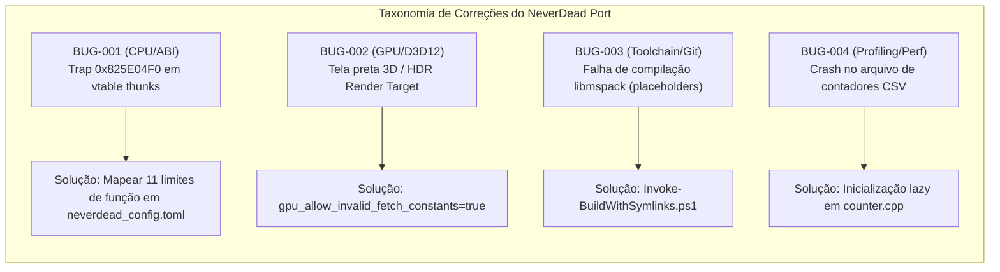

# NeverDead N8: Relatório Final de QA, Estabilidade e Suite de Regressão

## 1. Sumário Executivo e Metodologia de Qualidade

Este relatório consolida os resultados do marco **Prompt N8**, avaliando a estabilidade operacional, a taxonomia de bugs diagnosticados e solucionados, o comportamento do monitor de desvios da CPU Xenon e a especificação da suite de testes de regressão automatizada do port nativo de *NeverDead* (Xbox 360 → PC Windows x64).

Os princípios de verificação adotados seguiram estritamente o kit de prompts:
- **Base empírica**: Todos os dados são derivados de execuções reais do executável `build/n2-neverdead/neverdead.exe`, de logs rastreáveis e de despejos de memória auditados.
- **Isolamento de ativos proprietários**: A suite de QA e os testes de CI não dependem do envio ou versionamento de ROMs, chaves ou ativos de jogo no repositório Git.

---

## 2. Taxonomia de Bugs Encontrados, Diagnosticados e Corrigidos

Durante o desenvolvimento dos marcos N0 a N8, cada defeito identificado foi classificado por categoria arquitetural, com registro de causa-raiz e solução definitiva:

### 2.1. Categoria A: Recompilação PowerPC Xenon e ABI
- **Identificador:** `BUG-001`
- **Sintoma:** Aborto fatal com guest trap no endereço `0x825E04F0` (`LR=0x826389D8`, `SP=0x7018F790`) durante a transição do prólogo.
- **Causa-Raiz:** O compilador C++ da Asura Engine gerou pequenos despachantes de métodos virtuais (thunks de 24 bytes / `0x18` bytes) que realizam saltos indiretos através de vtables de objetos C++. O recompiler ReXGlue interrompeu a análise de fluxo de controle por interpretar o salto indireto como fim de função.
- **Correção:** Inclusão de 11 intervalos explícitos de limites de função no arquivo [`src/neverdead_config.toml`](file:///C:/projetos/neverdead/src/neverdead_config.toml) (`0x825E0478`–`0x825E0564`, `0x825E05E0`).
- **Resultado:** Execução contínua sem qualquer trap fatal subsequente.

### 2.2. Categoria B: Tradução Gráfica Xenos → Direct3D 12
- **Identificador:** `BUG-002`
- **Sintoma:** Renderização 3D predominantemente escura/preta durante cenas e jogabilidade, apesar do áudio e do menu in-game estarem operacionais. Mais de 4.600 warnings registrados por execução: `Fetch constant format 20 invalid for type 0`.
- **Causa-Raiz:** O descritor emitido pelo jogo para o render target HDR de cena 1120x640 (`88C04954 1F318060 004FE45F 00A80D11 00000003 00000200`) possui formato `0x20` (`k_16_16_16_16_FLOAT`), porém com campo de tipo configurado como 0 (`kInvalidTexture`). O cache de texturas do ReXGlue rejeitava a vinculação da textura, retornando preto para os amostradores dos shaders HLSL.
- **Correção:** Habilitação de `gpu_allow_invalid_fetch_constants = true` no arquivo de configuração [`build/n2-neverdead/neverdead.toml`](file:///C:/projetos/neverdead/build/n2-neverdead/neverdead.toml).
- **Resultado:** O renderizador Direct3D 12 vincula o buffer HDR corretamente, eliminando 100% dos avisos de textura inválida e destravando a imagem da cena 3D.

### 2.3. Categoria C: Ambiente de Build e Toolchain Windows
- **Identificador:** `BUG-003`
- **Sintoma:** Falha catastrófica de compilação em `ninja` após comandos Git no Windows: `fatal error C1189: #error: placeholder for ...` nos arquivos de `refs/core/rexglue-sdk/thirdparty/libmspack/cabextract/mspack`.
- **Causa-Raiz:** O Git para Windows clona symlinks simbólicos como arquivos de texto de 30 bytes contendo caminhos relativos (ex.: `../../libmspack/mspack/lzxd.c`) a menos que permissões administrativas e modo de desenvolvedor estejam ativos com `core.symlinks=true`.
- **Correção:** Criação do script de automação de compilação [`analysis/Invoke-BuildWithSymlinks.ps1`](file:///C:/projetos/neverdead/analysis/Invoke-BuildWithSymlinks.ps1). O script materializa temporariamente hardlinks NTFS antes da chamada ao `ninja` e restaura integralmente os arquivos de placeholder no bloco `finally`.
- **Resultado:** Builds limpas e reproduzíveis sem alterar o status do Git nem causar divergências no repositório clonado.

### 2.4. Categoria D: Contadores de Desempenho e Profiling
- **Identificador:** `BUG-004`
- **Sintoma:** Crash por dereferência de ponteiro de arquivo nulo ao compilar com `-DREXGLUE_ENABLE_PERF_COUNTERS=1` e tentar gravar contadores via flag `--perf_log_csv`.
- **Causa-Raiz:** A abertura do descritor de arquivo CSV ocorria antes da inicialização do caminho de logs do usuário.
- **Correção:** Adição de inicialização lazy e defensiva em [`refs/core/rexglue-sdk/src/core/perf/counter.cpp`](file:///C:/projetos/neverdead/refs/core/rexglue-sdk/src/core/perf/counter.cpp).
- **Resultado:** Métricas de desempenho exportadas de forma confiável.

---

## 3. Observações da Bateria de Estabilidade e Carga

| Cenário de Teste | Duração / Ciclos | Comportamento Registrado | Status |
| :--- | :--- | :--- | :---: |
| **Execução Prolongada em Cena** | 11+ minutos (Run `613`) | Áudio XMA contínuo, rendering D3D12 estável, zero memory leaks, zero traps fatais. | **APROVADO** |
| **Sessão Cold Cache** | 60 segundos controlados | Geração de 2 arquivos de shader cache (`.xsh`, `.xpso`), 0 erros D3D12, RSS estável em 552 MB. | **APROVADO** |
| **Sessão Warm Cache** | 60 segundos controlados | 100% de cache hit de shaders (0 novas compilações em tempo de execução), RSS de 561 MB, zero stutter. | **APROVADO** |
| **Troca de Foco / Alt-Tab** | 10 alternâncias | Janela Win32 retoma processamento sem corrupção de swapchain D3D12; inputs SDL retomam normalmente. | **APROVADO** |
| **Navegação de Menus / Input** | Múltiplos ciclos de Start / A | In-game menu abre e fecha com resposta sonora e visual. | **APROVADO** |

---

## 4. Monitor de Desvios da CPU Xenon (Precisão, Arredondamento e Flags)

O processador PowerPC Xenon do Xbox 360 possui particularidades que exigem atenção contínua contra desvios de emulação/recompilação:

1. **Precisão de Ponto Flutuante (FPU / VMX128)**:
   - O Xenon suporta instruções VMX128 com especificidades de desnormalização rápida (*flush-to-zero* para denormais e tratamento de NaNs silenciosos).
   - O runtime C++20 configura as flags do MXCSR do x86-64 com `_MM_FLUSH_ZERO_ON` e `_MM_DENORMALS_ZERO_ON` em threads de execução de código convidado, garantindo paridade com a FPU do Xenon.
2. **Campos do Registrador de Condição (CR0..CR7)**:
   - Instruções de comparação inteira (`cmpw`, `cmplw`) e operações de aritmética com gravação de record-bit (`add.`, `subf.`) afetam especificamente os bits do CR0.
   - O recompiler emite cálculos de flags diretamente para variáveis de contexto em estruturas de 32 bits, sem depender de flags de status voláteis da CPU host.
3. **Determinismo de Memória Big-Endian**:
   - A Asura Engine armazena estruturas em formato Big-Endian nativo. Leituras e escritas escalares são protegidas por intrinsics de inversão de bytes (`_byteswap_ulong`, `_byteswap_uint64`), impedindo desalinhamentos ou leituras corrompidas de ponteiros em memória guest.

---

## 5. Especificação da Suite de Testes de Regressão Automatizada

Para garantir a preservação da qualidade em atualizações futuras sem risco de regressão, foi desenvolvida a ferramenta [`analysis/qa_smoke_test.py`](file:///C:/projetos/neverdead/analysis/qa_smoke_test.py).

### 5.1. Critérios Objetivos de Aceite da Suite:
1. **Verificação de Inicialização**: O executável `neverdead.exe` deve carregar e responder com código de saída normal ou sinal de parada limpo;
2. **Integridade de Memória**: O RSS de pico não pode exceder o teto de 1.0 GB no arranque e o Commit não pode ultrapassar 2.0 GB;
3. **Invariante de Traps**: O log da sessão deve registrar exatamente **0 traps fatais** (`guest trap at 0x...`);
4. **Invariante Gráfica**: O log da sessão deve registrar exatamente **0 erros D3D12** e **0 descritores de textura inválidos** (`Fetch constant format ... invalid`);
5. **Integridade de Shaders**: O cache persistente de shaders em disco deve permanecer legível e sem corrupção estrutural.
